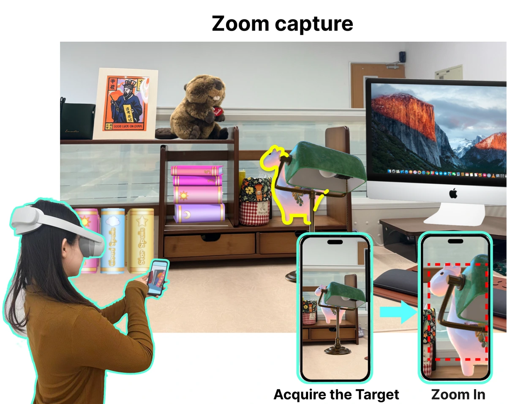
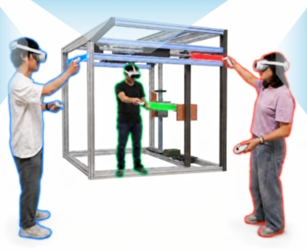
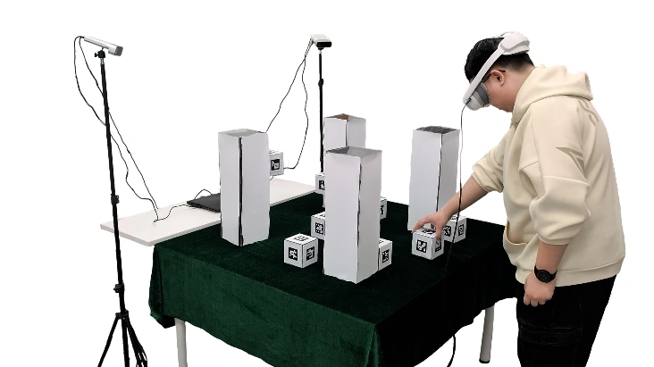
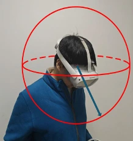
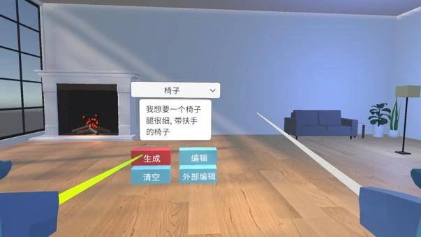
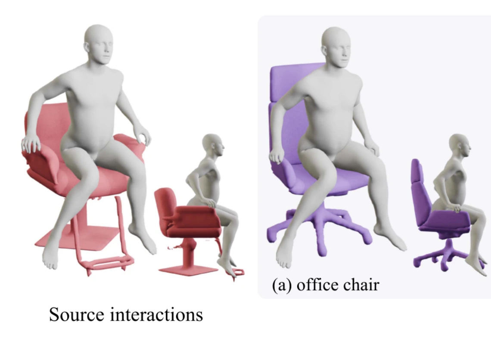

::: {#hero-heading}

## About {#about}

Dr. Jian Wu is an Assistant Researcher at the State Key Laboratory of Virtual Reality Technology and Systems, Beihang University. He received his Ph.D. in Computer Application Technology from Beihang University in 2024. His research focuses on immersive interaction and perceptual computing for virtual and mixed reality, including 3D interaction, haptic feedback, and real-time graphics.

## 🔬 Research Interests {#research-interests}

- **Immersive interaction:** 3D object manipulation, assembly guidance, collaboration, and navigation in VR/MR.
- **Perception and visual computing:** user perception and cybersickness, foveated rendering and streaming, and neural scene representation.
- **Haptics and multimodal interfaces:** haptic retargeting and multimodal interaction in immersive environments.

## 🔥 News {#news}

- **2026:** New publications on mixed-reality interaction, collaborative disassembly, haptic retargeting, and foveated 360-degree video streaming.

## 📝 Publications {#publications}

`*` indicates corresponding author.

::: {.pub-card}
{.pub-thumb}

::: {.pub-content}
### [SnapAxis: Axis Based Interaction for Object Manipulation in Mixed Reality](https://liliwang.net/publications/#paper-snapaxis-axis-based-interaction-for-object-manipulation-in-mixed-reality) {.pub-title}

Fengyi Yan, **Jian Wu**, Shuo Yan, Sio Kei Im, Lili Wang\*.

*UIST 2026.*

[PDF](https://liliwang.net/publications/PDF/2026/snapaxis-axis-based-interaction-for-object-manipulation-in-mixed-reality.pdf){.pub-btn target="_blank"}
[Video](https://www.youtube.com/watch?v=TDUKe1vlhF0){.pub-btn target="_blank"}
:::
:::

::: {.pub-card}
{.pub-thumb}

::: {.pub-content}
### [Collaborative Disassembly for Multiple Users in Virtual Reality](https://liliwang.net/publications/#paper-collaborative-disassembly-for-multiple-users-in-virtual-reality) {.pub-title}

Ziteng Wang, **Jian Wu**, Sichun Huang, Peike Wang, Peng Zhang, Min Zhang, Lili Wang\*.

*IEEE TVCG 2026.*

[PDF](https://liliwang.net/publications/PDF/2026/collaborative-disassembly-for-multiple-users-in-virtual-reality.pdf){.pub-btn target="_blank"}
[Video](https://www.youtube.com/watch?v=P2Y8j556Pq4){.pub-btn target="_blank"}
:::
:::

::: {.pub-card}
{.pub-thumb}

::: {.pub-content}
### [Direction-Aware 3D Haptic Retargeting in VR](https://liliwang.net/publications/#paper-direction-aware-3d-haptic-retargeting-in-vr) {.pub-title}

Zhikai Wen, **Jian Wu**, Runze Fan, Sio Kei Im, Lili Wang\*.

*IEEE ISMAR 2026.*

[PDF](https://liliwang.net/publications/PDF/2026/direction-aware-3d-haptic-retargeting-in-vr.pdf){.pub-btn target="_blank"}
[Video](https://www.youtube.com/watch?v=IYqXOFfJuV8){.pub-btn target="_blank"}
:::
:::

::: {.pub-card}
{.pub-thumb}

::: {.pub-content}
### [SGMRS: Spherical Gaussian Guided Multi-Resolution Sampling for Fast Foveated 360-Degree Video Streaming](https://liliwang.net/publications/#paper-sgmrs-spherical-gaussian-guided-multi-resolution-sampling-for-fast-foveated-360-degree-video-streaming) {.pub-title}

**Jian Wu**, Yichuan Liu, Qifei Xu, Binsheng Zhang, Xinda Liu, Xuehuai Shi, Runze Fan, Lili Wang\*.

*IEEE ISMAR 2026.*

[PDF](https://liliwang.net/publications/PDF/2026/sgmrs-spherical-gaussian-guided-multi-resolution-sampling-for-fast-foveated-360-degree-video-streaming.pdf){.pub-btn target="_blank"}
[Video](https://www.youtube.com/watch?v=0wWjQpjQhrQ){.pub-btn target="_blank"}
:::
:::

::: {.pub-card}
{.pub-thumb}

::: {.pub-content}
### [Speaking to Edit: LLM-Guided Semantic Interactive Part Editing of AI-generated 3D Models in Immersive Virtual Environments](https://liliwang.net/publications/#paper-speaking-to-edit-llm-guided-semantic-interactive-part-editing-of-ai-generated-3d-models-in-immersive-virtual-environments) {.pub-title}

**Jian Wu**, Liya Chen, Zhenming Zhang, Haokun Luo, Lili Wang\*, Kaiyue Li, Wen Wu, Chaoji Chen.

*ICXR 2026.*

[PDF](https://liliwang.net/publications/PDF/2026/speaking-to-edit-llm-guided-semantic-interactive-part-editing-of-ai-generated-3d-models-in-immersive-virtual-environments.pdf){.pub-btn target="_blank"}
:::
:::

::: {.pub-card}
{.pub-thumb}

::: {.pub-content}
### [Spatial-Temporal Relation Guided Motion Transfer via Diffusion Model](https://liliwang.net/publications/#paper-spatial-temporal-relation-guided-motion-transfer-via-diffusion-model) {.pub-title}

Yuan Li, **Jian Wu**, Runze Fan, Sio Kei Im, Lili Wang\*.

*IEEE TVCG 2026.*

[PDF](https://liliwang.net/publications/PDF/2026/spatial-temporal-relation-guided-motion-transfer-via-diffusion-model.pdf){.pub-btn target="_blank"}
[Video](https://www.youtube.com/watch?v=gKLh1Z56kPQ){.pub-btn target="_blank"}
:::
:::

[All publications](publications.qmd).

## 🎖 Honors and Awards {#honors-and-awards}

- **2025:** IEEE VR Best Paper Honorable Mention for Fov-GS.
- **2024:** IEEE ISMAR Best Student Journal Paper Award for VPRF.

## 📖 Education {#education}

- **2018–2024:** Ph.D. in Computer Application Technology, School of Computer Science and Engineering, Beihang University, Beijing, China.
- **2015–2018:** M.S. in Mechanical Engineering (Major in Mechanical Design), School of Mechanical Engineering and Automation, Beihang University, Beijing, China.
- **2011–2015:** B.E. in Mechanical Engineering and Automation, School of Mechanical Engineering and Automation, Beihang University, Beijing, China.

## 💼 Professional Experience {#professional-experience}

- **2024–Present:** Assistant Researcher, State Key Laboratory of Virtual Reality Technology and Systems, Beihang University, Beijing, China.

:::